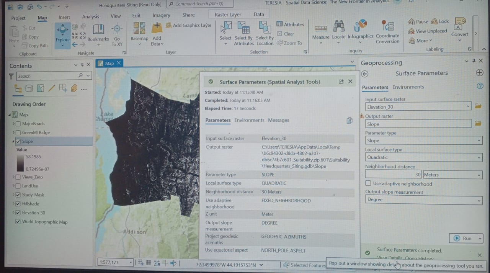
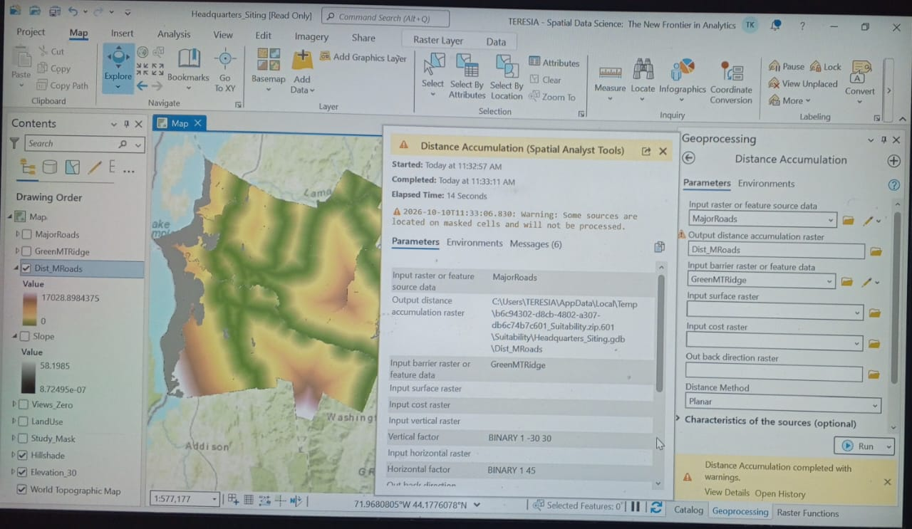
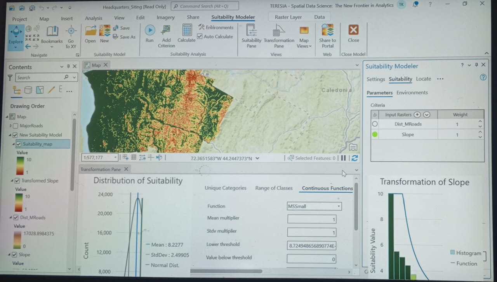
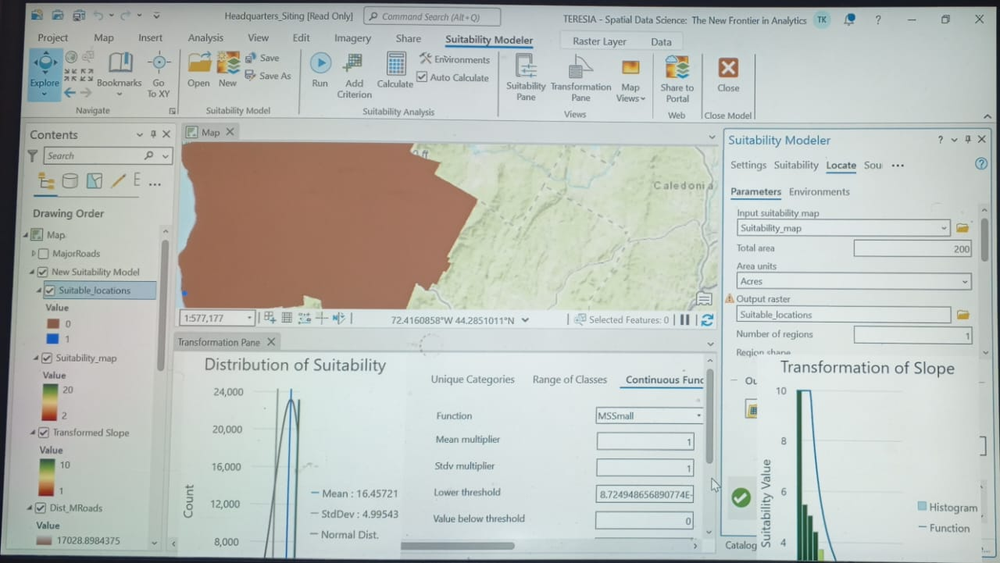

# Vermont Corporate Headquarters Siting Pipeline
An end-to-end spatial data engineering project completed inside ArcGIS Pro to determine the optimal 200-acre site boundary for a corporate headquarters in Vermont.

## Core Technical Milestones & Visual Assets

### 1. Surface Parameter Modeling 
- **Tool Executed:** Surface Parameters (Spatial Analyst)
- **Input Surface Ingestion:** Elevation_30
- **Output Layer Generation:** Slope Raster Array
- **Processing Time:** 17 Seconds Flat
- **Objective:** Calculated regional terrain steepness grids to eliminate structural slope hazards from candidate site profiles.

### 2. Distance Accumulation Matrix 
- **Tool Executed:** Distance Accumulation (Spatial Analyst)
- **Primary Source Input:** MajorRoads
- **Barrier Constraint Boundary:** GreenMTRidge
- **Spatial Mask Filter:** Study_Mask (30m Cell Size Resolution)
- **Objective:** Computed continuous Euclidean travel proximity corridors around major highway infrastructure while strictly routing around impassable mountain ridges.

### 3. Multi-Criteria Suitability Modeler Transformation 
- **Framework Implemented:** Esri Suitability Modeler Tab
- **Transformation Scaling Array:** Continuous 1-to-10 Rescaling Scales
- **Overlay Weight Allocations:** Dist_MRoads (Weight: 3) | Slope (Weight: 2)
- **Objective:** Executed mathematical cell-overlay algebra to analyze cross-functional suitability surfaces and visualize transformation curves.

### 4. Regional Growth Optimization & Site Localization 
- **Locate Constraints:** Total Area Target = 200 Acres | Region Allocation = 1
- **Objective:** Ran advanced regional growth algorithms to analyze suitability surfaces, successfully drawing a highlighted vector polygon bounding the absolute highest-scoring 200 acres for the facilities deployment.

---
### 📫 Enterprise Allocations & Consulting Contracts
To deploy, scale, or integrate this automated predictive AI pipeline for your organization, retain my systems engineering stack directly through [My Upwork Console](https://www.upwork.com/freelancers/~014e56546866817167?mp_source=share).
